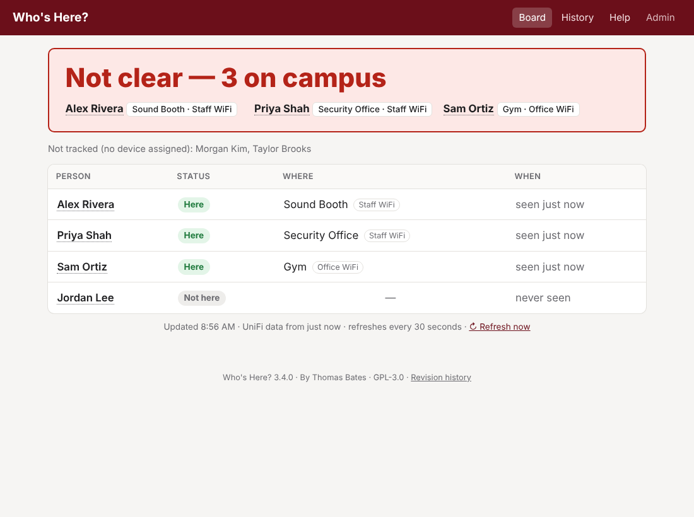
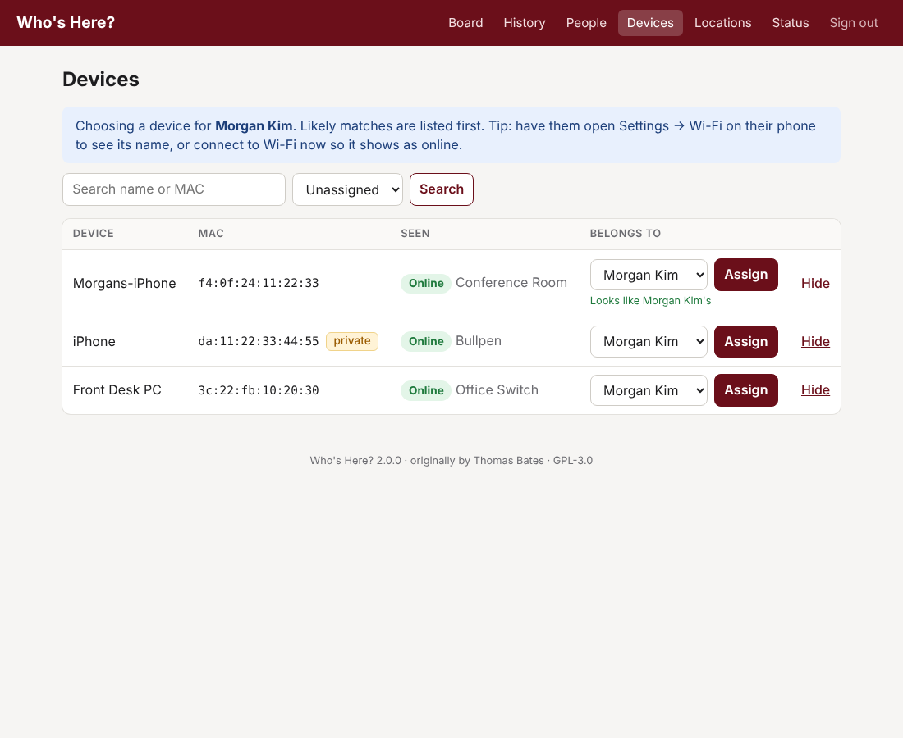

# Who's Here? 2.0

An automatic in/out board for UniFi networks. It watches which staff phones are connected to your Wi-Fi and answers one question at the end of the night: **is everyone gone, so it's safe to arm the alarm?**



It's a rewrite of [Who's Here? v1](https://github.com/batesta/whoshere) (2020, PHP). Same idea, built to run as a single Docker container on a Synology NAS.

## What's new since v1

| | v1 | 2.0 |
|---|---|---|
| End-of-night answer | Read the table | **All clear to arm** / **Not clear — 3 on campus** / **Can't confirm** banner |
| When UniFi is unreachable | Everyone looks "Not Here" | Board refuses to say "all clear" and says why |
| Adding staff | Edit `users.txt` by hand, look up MACs yourself | Pick their phone from a list of devices UniFi has seen; name matches are suggested |
| Access point names | Hard-coded in `config.php`; a new AP made people vanish | Pulled from UniFi automatically, with optional display names |
| History | Last-seen time only | Every arrival and departure, filterable by person and date range |
| Phone dozing for a few minutes | Flips to Not Here | 10-minute grace period (configurable) before anyone counts as gone |
| UniFi sign-in | Username/password, UniFi 5.x API | API key (UniFi Network 9+), or username/password as a fallback |
| Runs on | PHP + web server | One Docker container; data in a single SQLite file |

## Screens

| All clear | Assigning a device | History |
|---|---|---|
|  |  |  |

## Setup

### 1. Make a UniFi API key

Recommended for UniFi Network 9.0 and newer (built and tested against the API in Network 10.x):

1. In UniFi OS, create a local admin just for this (for example `whoshere`) with **View Only** access to the Network app. The API key gets the permissions of the account that creates it, so a view-only account keeps the key harmless.
2. Sign in as that account, open **UniFi Network → Settings → Control Plane → Integrations**, and create an API key. Copy it; UniFi only shows it once.

If you can't use an API key, leave it blank and set `UNIFI_USERNAME` / `UNIFI_PASSWORD` to a read-only local account instead (what v1 did). That also works with older self-hosted controllers.

### 2. Run it on the Synology

1. Install **Container Manager** from Package Center.
2. In File Station, create a folder such as `docker/whoshere` and copy this repository into it.
3. Copy `.env.example` to `.env` in that folder and fill in at least `UNIFI_URL`, `UNIFI_API_KEY` and `ADMIN_PASSWORD`.
4. In Container Manager → **Project** → **Create**, pick that folder. It finds `docker-compose.yml` and builds the image.
5. Open `http://<your-nas>:8085`.

Prefer not to build on the NAS? In `docker-compose.yml`, replace `build: .` with the `image: ghcr.io/...` line. GitHub Actions publishes an image (Intel and ARM) on every push to `main`.

Data (people, devices, history) lives in the `whoshere-data` Docker volume. It survives updates and rebuilds.

### 3. First run

1. Click **Admin** and sign in with `ADMIN_PASSWORD`.
2. **Status**: check that it says *Connected to UniFi*. If not, the error says what's wrong (bad key, wrong address, unknown site…).
3. **People**: add staff, or paste your old v1 `users.txt` into **Import from Who's Here v1**.
4. For anyone without a device, click **Assign a device**. Phones currently online are listed first, along with any whose name matches the person ("Toms-Pixel-8" → Tom). Pick it and click **Assign**.
5. **Locations** (optional): rename access points if their UniFi names aren't friendly.

Each tracked phone must have **Private Wi-Fi Address** (iOS) / **Randomized MAC** (Android) turned off for your network. Otherwise its MAC address changes and the person disappears. Devices using a private address are tagged **private** in the list.

### 4. Let staff add their own phone (optional)

Set `SELF_REGISTER=true` and staff can open `http://<server>:8085/register` **on their phone, while connected to the staff Wi-Fi**. The app asks UniFi which device has that phone's IP address, takes its MAC from UniFi (never from the browser), and adds it under the name they type. Typing a name that's already on the board adds the phone to that person, so a new phone replaces nothing and needs no admin.

- If the phone is using a private Wi-Fi address, the page refuses it and shows iPhone and Android steps for turning that off on `STAFF_WIFI_NAME`.
- If the phone is already registered, the page says to whom.
- Set `REGISTER_CODE` so only people you've told the code can register. Anyone on the staff Wi-Fi can use the page otherwise.
- The page needs to see the phone's real IP address. Open the app directly by its port, or, if you put a reverse proxy in front of it, set `FORWARDED_ALLOW_IPS` to the proxy's address.

A QR code for `/register` on the staff-room wall works well.

## Moving to a new server

1. On the old server, open **Backup** (admin), tick **Include arrival & departure history** if you want it, and click **Download export**. The file holds people, their devices, custom location names and hidden devices.
2. Set up the new server as in [Setup](#setup), copying your `.env` file. Passwords and UniFi settings aren't in the export.
3. On the new server, open **Backup**, choose the file and click **Import**.
   - **Add to this server** (the default) matches people by name and never removes anything, so it's safe to run twice.
   - **Replace everything** first deletes all people, device assignments, location names and history on the new server. You have to type `REPLACE` to confirm.

The Backup page also accepts a v1 `users.txt`. The same thing works from a terminal:

```sh
python -m whoshere export /data/whoshere-export.json --history
python -m whoshere import /data/whoshere-export.json            # add --replace to wipe first
```

## How it decides

- Someone is **Here** as soon as any of their devices is connected, and their location is the access point it's connected to. If they have both a phone and a laptop, the phone (wireless) wins.
- They **leave** once none of their devices has been seen for `DEPARTURE_GRACE_MINUTES` (default 10). The departure is logged at the time they were last seen. While they're in that grace period the board shows "Here?" and they still block "All clear".
- The grace period only counts time the app could actually see UniFi. If the console reboots for an hour, nobody gets marked as gone because of it.
- If there's been no good answer from UniFi for `STALE_AFTER_SECONDS` (default 3 minutes), the board shows **Can't confirm — check manually** instead of "All clear".
- People with no device assigned are listed under the banner as not tracked, so it's obvious they aren't covered.

## Configuration

All settings are environment variables in `.env`; see [`.env.example`](.env.example) for the full list with explanations.

| Variable | Default | |
|---|---|---|
| `UNIFI_URL` | | Console address, e.g. `https://192.168.1.1` |
| `UNIFI_API_KEY` | | Recommended sign-in |
| `UNIFI_USERNAME` / `UNIFI_PASSWORD` | | Fallback sign-in |
| `UNIFI_SITE` | `default` | Site name or short code |
| `UNIFI_VERIFY_SSL` | `false` | UniFi uses a self-signed certificate |
| `ADMIN_PASSWORD` | | Required to manage people/devices |
| `VIEW_PASSWORD` | | Optional password for the board and history |
| `SITE_TITLE` | `Who's Here?` | |
| `TZ` | `America/Phoenix` | |
| `POLL_INTERVAL_SECONDS` | `60` | |
| `DEPARTURE_GRACE_MINUTES` | `10` | |
| `STALE_AFTER_SECONDS` | `180` | |
| `HISTORY_DAYS` | `365` | |
| `DEVICE_RETENTION_DAYS` | `30` | Forget unassigned (guest) devices after this |
| `SELF_REGISTER` | `false` | Turn on the `/register` page so staff can add their own phone |
| `REGISTER_CODE` | | Optional code staff must enter on `/register` |
| `STAFF_WIFI_NAME` | `the staff Wi-Fi` | Network name used in the instructions, e.g. `Ironwood Staff` |
| `FORWARDED_ALLOW_IPS` | `127.0.0.1` | Reverse proxies whose `X-Forwarded-For` header is trusted |

## JSON API

`GET /api/status` returns the board as JSON (uses `VIEW_PASSWORD` if set), handy for a wall display, Home Assistant, or an alarm-panel script:

```json
{
  "all_clear": false,
  "verdict": "occupied",
  "on_site": [{"name": "Alex Rivera", "location": "Sound Booth", "since": 1794520674.4, "last_seen": 1794521004.1, "leaving": false}],
  "last_success": 1794521004.1,
  "last_error": null
}
```

`verdict` is `clear`, `occupied`, or `stale`. Treat anything other than `clear` as "don't arm". `GET /healthz` is for container health checks.

## Command line

Run inside the container (Container Manager → container → **Terminal**, or `docker exec -it whoshere ...`):

```sh
python -m whoshere poll-once              # test the UniFi connection and list access points
python -m whoshere import-users users.txt # import a v1 users.txt
python -m whoshere export FILE --history  # export people, devices, location names (and history)
python -m whoshere import FILE [--replace] # import an export or a v1 users.txt
```

## Development

```sh
pip install -r requirements.txt pytest
pytest                                   # unit tests, including against a fake UniFi console
python tests/mock_unifi.py 8443 &        # fake console: API key "test-key"
DATA_DIR=./data UNIFI_URL=http://127.0.0.1:8443 UNIFI_API_KEY=test-key ADMIN_PASSWORD=admin python -m whoshere
```

Python 3.13, Starlette, Jinja2 and SQLite; no JavaScript build step. The code is in `whoshere/`:

- `unifi.py` turns UniFi's API responses into a snapshot.
- `presence.py` holds the rules above.
- `web.py` is the UI.

## Releasing a change

Every change bumps the version: the minor number (2.1 → 2.2) for small and most changes, the major number (2.x → 3.0) for big ones.

1. Set `__version__` in `whoshere/__init__.py`.
2. Add an entry at the top of `whoshere/changelog.py` listing what changed. It appears on the **Revision history** page, linked from every page's footer. A test fails if the two don't match.

## License

GPL-3.0, same as v1. By Thomas Bates.
