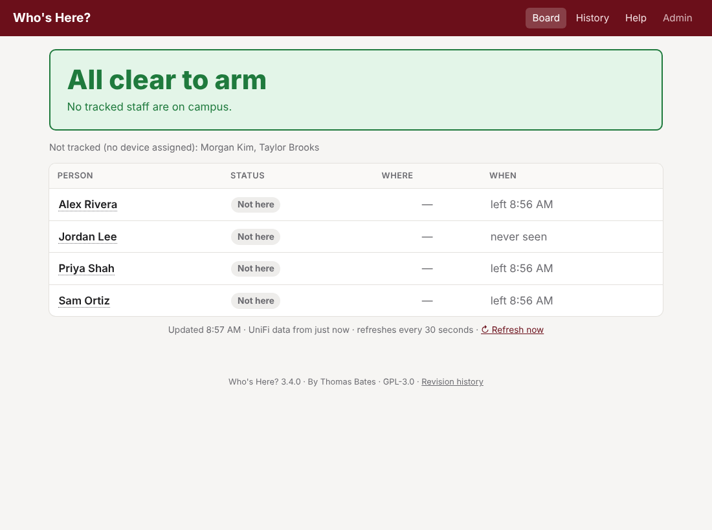
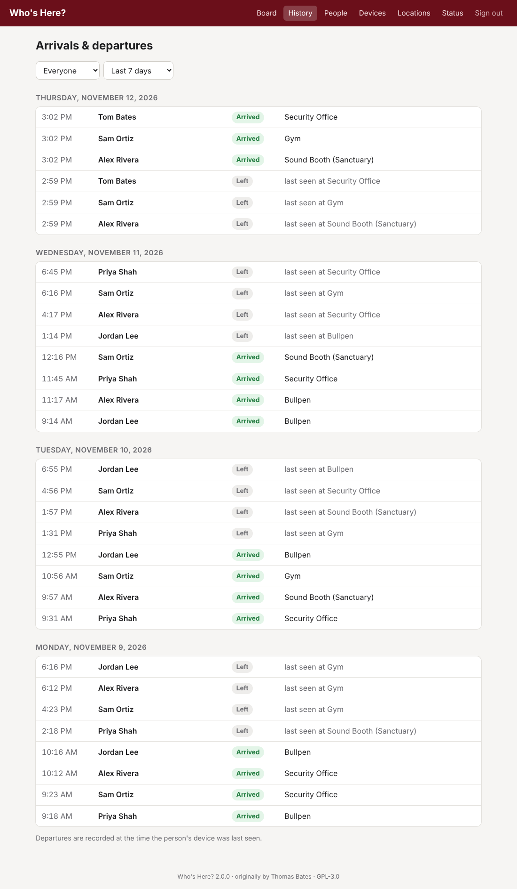

# Who's Here? 2.0

An automatic in/out board for UniFi networks. It watches which staff phones are connected to your Wi-Fi and answers one question at the end of the night: **is everyone gone, so it's safe to arm the alarm?**


It's a rewrite of [Who's Here? v1](https://github.com/batesta/whoshere) (2020, PHP). Same idea, built to run as a single Docker container on a Synology NAS.

## What's new since v1

| | v1 | 2.0 |
|---|---|---|
| End-of-night answer | Read the table | **All clear to arm** / **Not clear — 3 on campus** / **Can't confirm** banner |
| When UniFi is unreachable | Everyone looks "Not Here" | Board refuses to say "all clear" and says why |
| Adding staff | Edit `users.txt` by hand, look up MACs yourself | Pick their phone from a list of devices UniFi has seen; name matches are suggested |
| Access point names | Hard-coded in `config.php`; a new AP made people vanish | Pulled from UniFi automatically, with optional display names |
| History | Last-seen time only | Every arrival and departure, filterable by person and date range |
| Phone dozing for a few minutes | Flips to Not Here | 10-minute grace period (configurable) before anyone counts as gone |
| UniFi sign-in | Username/password, UniFi 5.x API | API key (UniFi Network 9+), or username/password as a fallback |
| Runs on | PHP + web server | One Docker container; data in a single SQLite file |

## Screens

| All clear | Assigning a device | History |
|---|---|---|
|  |  |  |

## Setup

### 1. Make a UniFi API key

Recommended for UniFi Network 9.0 and newer (built and tested against the API in Network 10.x):

1. In UniFi OS, create a local admin just for this (for example `whoshere`) with **View Only** access to the Network app. The API key gets the permissions of the account that creates it, so a view-only account keeps the key harmless.
2. Sign in as that account, open **UniFi Network → Settings → Control Plane → Integrations**, and create an API key. Copy it; UniFi only shows it once.

If you can't use an API key, leave it blank and set `UNIFI_USERNAME` / `UNIFI_PASSWORD` to a read-only local account instead (what v1 did). That also works with older self-hosted controllers.

### 2. Run it

#### Portainer (recommended)

The repository is private, so Portainer needs a read-only GitHub token to fetch it. To make one: **GitHub → Settings → Developer settings → Personal access tokens → Fine-grained tokens → Generate new token**.
- **Repository access:** *Only select repositories* → `whoshere2`
- **Permissions:** *Contents: Read-only*
- **Expiration:** pick a date and put a reminder in your calendar. When it expires, Portainer can't pull updates until you paste in a new one.

1. **Stacks → + Add stack**, name it `whoshere`.
2. Build method **Repository**:
   - Repository URL: `https://github.com/ThomasBates-AZ/whoshere2`
   - Repository reference: `refs/heads/main`
   - Compose path: `whoshere2/docker-compose.yml`
   - **Authentication**: on. Username: your GitHub username. Personal access token: the token above.
3. Optional: turn on **GitOps updates** (polling) so the stack redeploys by itself whenever `main` changes.
4. **Environment variables → Advanced mode**: paste your settings from [`.env.example`](.env.example). At least `UNIFI_URL`, `UNIFI_API_KEY` and `ADMIN_PASSWORD`; anything left out uses its default.
5. **Deploy the stack**, then open `http://<docker-host>:8085`. The footer shows the version that's running.

**On Synology (or if "Add my phone" can't find phones):** add `NETWORK_MODE=host` to the environment variables. In Docker's default bridge mode, Synology hands the app every connection from Docker's internal address (like `172.17.0.1`) instead of the phone's. Host mode uses the server's own network so the real addresses come through. In host mode the board is on `PORT` (default 8080) rather than `HOST_PORT`, so set `PORT=8085` to keep the same address, or another free port. Docker prints a harmless "published ports are discarded" warning in host mode. The **Status** page flags it when the app is only seeing Docker's internal address.

To update later, open the stack and click **Pull and redeploy** (or let GitOps updates do it).

#### Synology Container Manager or plain Docker Compose

1. Copy this folder to the server (on a Synology, e.g. `docker/whoshere` in File Station).
2. Copy `.env.example` to `.env` next to `docker-compose.yml` and fill in at least `UNIFI_URL`, `UNIFI_API_KEY` and `ADMIN_PASSWORD`.
3. Container Manager → **Project** → **Create** and pick the folder, or run `docker compose up -d` there.
4. Open `http://<server>:8085`.

#### Pre-built image

Every merge to `main` publishes `ghcr.io/thomasbates-az/whoshere2` (Intel and ARM, tagged `latest` and the version number). Because the repository is private, the image is private too. Pulling it needs a GitHub *classic* token with the `read:packages` scope, added in Portainer under **Registries**. For most setups, building from the repository as above is simpler.

Data (people, devices, history) lives in the `whoshere-data` Docker volume. It survives updates and rebuilds.

### 3. First run

1. Click **Admin** and sign in with `ADMIN_PASSWORD`.
2. **Status**: check that it says *Connected to UniFi*. If not, the error says what's wrong (bad key, wrong address, unknown site…).
3. **People**: add staff, or paste your old v1 `users.txt` into **Import from Who's Here v1**.
4. For anyone without a device, click **Assign a device**. Phones currently online are listed first, along with any whose name matches the person ("Taylors-Pixel-8" → Tom). Pick it and click **Assign**.
5. **Locations** (optional): rename access points if their UniFi names aren't friendly.

Each tracked phone must have **Private Wi-Fi Address** (iOS) / **Randomized MAC** (Android) turned off for your network. Otherwise its MAC address changes and the person disappears. Devices using a private address are tagged **private** in the list.

### 4. Let staff add their own phone (optional)

Set `SELF_REGISTER=true` and staff can open `http://<server>:8085/register` **on their phone, while connected to the staff Wi-Fi**. The app asks UniFi which device has that phone's IP address, takes its MAC from UniFi (never from the browser), and adds it under the name they type. Typing a name that's already on the board adds the phone to that person, so a new phone replaces nothing and needs no admin.

- If the phone is using a private Wi-Fi address, the page refuses it and shows iPhone and Android steps for turning that off on the network it's connected to.
- If `WIFI_NETWORKS` is set and the phone is on another network (a guest Wi-Fi, say), the page asks them to switch to a staff network first.
- If the phone is already registered, the page says to whom.
- Set `REGISTER_CODE` so only people you've told the code can register. Anyone on the staff Wi-Fi can use the page otherwise.
- The page needs to see the phone's real IP address. On Synology that means `NETWORK_MODE=host` (see [Run it](#2-run-it)). If you put a reverse proxy in front of the app, set `FORWARDED_ALLOW_IPS` to the proxy's address.

A QR code for `/register` on the staff-room wall works well.

## Help for staff

The **Help** tab is a plain-language guide for everyone. It covers reading the board, checking before you arm the alarm, History (click any name to see that person's history), setting up a phone, putting the board on a phone's home screen, and Google Chat.

Two one-page cheat sheets are linked from Help: a **Quick guide** and a **Google Chat guide**. They open with this board's own address filled in, and have a **Print / Save as PDF** button. Ready-made PDFs with a blank address line ship in `whoshere/static/help/`. To regenerate them, or to make copies with your address printed on them:

```sh
pip install playwright && playwright install chromium
python tools/make_cheatsheets.py --out ~/Desktop --board-url http://whoshere.example.org:8085 --self-register
```

## Moving to a new server

1. On the old server, open **Backup** (admin), tick **Include arrival & departure history** if you want it, and click **Download export**. The file holds people, their devices, custom location names and hidden devices.
2. Set up the new server as in [Setup](#setup), copying your `.env` file. Passwords and UniFi settings aren't in the export.
3. On the new server, open **Backup**, choose the file and click **Import**.
   - **Add to this server** (the default) matches people by name and never removes anything, so it's safe to run twice.
   - **Replace everything** first deletes all people, device assignments, location names and history on the new server. You have to type `REPLACE` to confirm.

The Backup page also accepts a v1 `users.txt`. The same thing works from a terminal:

```sh
python -m whoshere export /data/whoshere-export.json --history
python -m whoshere import /data/whoshere-export.json            # add --replace to wipe first
```

## More than one staff Wi-Fi network

Who's Here sees every device on the UniFi site, whichever network it joined, so staff are tracked on all of your networks with no setup. Two settings make several networks easier to live with:

- `WIFI_NETWORKS=Staff WiFi, Office WiFi` lists your staff networks. The **Devices** list then only shows phones on those networks (there's a link to show everything), and **Add my phone** only accepts phones on them.
- `SHOW_WIFI_NETWORK=true` (the default) shows the network next to each person's location on the board, and on the Devices and History pages.

Phones keep Private Wi-Fi Address per network, so staff need it **off on each staff network**. Otherwise the same phone shows up under a different MAC address on the other one. If that has already happened, assign both addresses to the person on the **Devices** page.

With an API key, the network names come from UniFi's classic client list, read with the same key. If a console doesn't allow that, everything else keeps working without network names, and **Status** says so.

## Google Chat

Staff can ask Who's Here from Google Chat:

| Command | What it does |
|---|---|
| `/whoshere` | Who's on campus right now, and where |
| `/whoshere Taylor` | Everyone whose name contains "Taylor": here (where, since when) or last seen |
| `/allclear` | Is it safe to arm the alarm? All clear, who's still here (and who may be leaving), or "can't confirm" if UniFi data is out of date |
| `/history` / `/history Taylor` | Today's arrivals and departures |

In a direct message with the app, plain words work too: "all clear?", a name, "history", "help". In a shared space, replies are visible only to the person who asked (change with `GOOGLE_CHAT_PRIVATE_REPLIES=false`).

**How it connects:** Google Chat puts each message for the app into a Google Cloud **Pub/Sub** queue, and Who's Here fetches from that queue and replies through the Chat API. All connections go *out* from your server, so nothing on your network is opened to the internet, and it works behind the church firewall.

**What you need:** a Google Workspace edition that includes Google Chat, admin access to Google Cloud for your domain, and a Google Cloud project with **billing enabled**. Pub/Sub is required to have billing on, though a handful of messages a day should fall well within its free tier.

### Step 1: Create the Google Cloud project

1. Go to [console.cloud.google.com](https://console.cloud.google.com), signed in with your Workspace account.
2. Create a project, e.g. **whoshere**, under your organization. Note its **project ID** (e.g. `example-whoshere`).
3. **APIs & Services → Library**: enable **Google Chat API** and **Cloud Pub/Sub API**.

### Step 2: Create the Pub/Sub topic and subscription

1. **Pub/Sub → Topics → Create topic**, ID `whoshere-chat`. Untick *Add a default subscription*.
2. Open the topic → **Permissions** → **Add principal**: `chat-api-push@system.gserviceaccount.com`, role **Pub/Sub Publisher**. This lets Google Chat put messages in the queue.
3. **Pub/Sub → Subscriptions → Create subscription**:
   - Subscription ID: `whoshere-chat`
   - Topic: `projects/<project-id>/topics/whoshere-chat`
   - Delivery type: **Pull**
   - Expiration period: **Never expire**
   - Leave the rest as is.

### Step 3: Create the service account (Who's Here's identity)

1. **IAM & Admin → Service Accounts → Create service account**, name `whoshere-chat`. It needs no project roles; skip those steps.
2. Open the subscription from step 2 → **Permissions** → **Add principal**: the service account's email (`whoshere-chat@<project-id>.iam.gserviceaccount.com`), role **Pub/Sub Subscriber**.
3. Open the service account → **Keys → Add key → Create new key → JSON**. A `.json` file downloads. Keep it private: it's a password for the app, and Google disables keys it finds published online. Never put it in GitHub.

> **"Key creation is disabled"?** Google Cloud organizations created since May 2024 block service account keys by default. An organization admin can allow them for just this project: **IAM & Admin → Organization Policies** (with the project selected) → *Disable service account key creation* (`iam.managed.disableServiceAccountKeyCreation`, or the older `iam.disableServiceAccountKeyCreation`) → **Manage policy** → **Override parent's policy** → **Not enforced** → Save. This needs the *Organization Policy Administrator* role.

### Step 4: Configure the Chat app

**APIs & Services → Enabled APIs → Google Chat API → Configuration**:

- **Build this Chat app as a Google Workspace add-on**: if this box is shown and ticked, untick it and confirm **Disable**. (Who's Here understands both formats, but these steps assume it's off.)
- **App name**: `Who's Here`
- **Avatar URL**: a public `https` link to the app icon. Upload [`docs/chat-avatar.png`](docs/chat-avatar.png) somewhere public, such as your organization's website, and use that link. (This repository is private, so GitHub links to the file won't work.) Set the same link as `CHAT_AVATAR_URL` to show the icon at the top of Chat answers too.
- **Description**: `Who's on campus, and is it safe to arm?`
- **Functionality**: tick **Join spaces and group conversations** if you want to use it in spaces as well as direct messages.
- **Connection settings**: **Cloud Pub/Sub**, topic `projects/<project-id>/topics/whoshere-chat`. If this section shows a service account email, give that account **Pub/Sub Publisher** on the topic as well, as in step 2.
- **Commands → Add a command**, three times, each as a **Slash command**:

  | Command ID | Name | Description |
  |---|---|---|
  | `1` | `/whoshere` | Who's on campus. Add a name to look someone up |
  | `2` | `/allclear` | Is it safe to arm the alarm? |
  | `3` | `/history` | Today's arrivals and departures |

  The IDs must be exactly these. The admin page in Who's Here lists them too.
- **Visibility**: *Make this Chat app available to specific people and groups in your domain*, and enter the people or a Google Group (e.g. `staff@yourchurch.org`). Only they can find and use the app.
- **Logs**: *Log errors to Logging*.
- **Save**.

### Step 5: Turn it on in Who's Here

1. Add to the stack's environment variables in Portainer, then **Update the stack**:
   ```
   GOOGLE_CHAT_SUBSCRIPTION=projects/<project-id>/subscriptions/whoshere-chat
   BOARD_URL=http://<your-server>:8085
   ```
   `BOARD_URL` is optional and adds a link to the board to replies. `GOOGLE_CHAT_ALLOWED` (optional) limits who may use it, e.g. `@yourchurch.org` or a list of emails.
2. In Who's Here, **Admin → Google Chat**: upload the `.json` key from step 3, click **Test the key**, and check that the status says **Connected**.

### Step 6: Use it

- In Google Chat, click **New chat**, search for **Who's Here**, and send `/whoshere`.
- To add it to a space: open the space → space name → **Apps & integrations** → **Add apps** → **Who's Here**.

If staff can't find or add the app, a Workspace admin should check **admin.google.com → Apps → Google Workspace → Google Chat → Chat apps** and allow users to install Chat apps.

### Troubleshooting

The **Google Chat** admin page shows what's wrong in plain words:
- **"Google rejected the service account key"**: upload a fresh key.
- **"Not allowed to read…"**: the service account is missing **Pub/Sub Subscriber** on the subscription.
- **"Subscription … not found"**: check `GOOGLE_CHAT_SUBSCRIPTION` against the full name shown in Pub/Sub.
- **Connected, but the app never answers**: Chat can't publish to the topic. Recheck the **Pub/Sub Publisher** grant in step 2, and the topic name in the Chat app's connection settings.

## Apple Watch

The watch app in [`watch/`](../watch) shows the board on your wrist: the all-clear answer, who's on campus and where, and complications for the watch face. It can also tap you when it becomes **all clear to arm**. It never shows Wi-Fi network names.

- **Reading the board:** the watch connects to Who's Here directly, so it has to be able to reach the server: on the campus network, or from outside through a VPN (UniFi Teleport, WireGuard). Off the network it shows its last answer and says it can't reach the board.
- **Notifications:** sent from the server through Apple's push service, so they arrive anywhere the watch has a connection. The server only makes outgoing connections to Apple.

Building the app needs a Mac with Xcode and a paid Apple Developer Program membership (push notifications aren't available to free accounts). The steps are in [`watch/README.md`](../watch/README.md). Then, on the server:

1. On [developer.apple.com](https://developer.apple.com/account/resources/authkeys/list) → **Certificates, Identifiers & Profiles → Keys**, click **+**, name it `Who's Here push`, tick **Apple Push Notifications service (APNs)**, and download the `.p8` file. Apple only lets you download it once. Note the **Key ID** shown next to it, and your **Team ID** (top right, or under **Membership**).
2. Add to the stack's environment variables and redeploy:
   - `APNS_KEY_ID` and `APNS_TEAM_ID` from step 1
   - `APNS_BUNDLE_ID`: the watch app's bundle ID (for example `org.example.whoshere.watchkitapp`)
   - `APNS_SANDBOX=true` while you install the app from Xcode; `false` for TestFlight or App Store builds
3. **Admin → Apple Watch**: upload the `.p8` key.
4. Open the app on the watch, enter the board's address in its Settings, and allow notifications. The watch appears under **Watches** on the admin page; click **Send a test notification**.

`WATCH_PUSH` chooses what gets announced: `clear` (default), `clear,stale` to also hear when the board can't confirm because UniFi stopped answering, or `none`. To keep other devices on your network from reading `/api/status`, set `API_TOKEN` and enter the same token in the watch app's Settings.

## How it decides

- Someone is **Here** as soon as any of their devices is connected, and their location is the access point it's connected to. If they have both a phone and a laptop, the phone (wireless) wins.
- They **leave** once none of their devices has been seen for `DEPARTURE_GRACE_MINUTES` (default 10). The departure is logged at the time they were last seen. While they're in that grace period the board shows "Here?" and they still block "All clear".
- The grace period only counts time the app could actually see UniFi. If the console reboots for an hour, nobody gets marked as gone because of it.
- If there's been no good answer from UniFi for `STALE_AFTER_SECONDS` (default 3 minutes), the board shows **Can't confirm — check manually** instead of "All clear".
- People with no device assigned are listed under the banner as not tracked, so it's obvious they aren't covered.

## Configuration

All settings are environment variables in `.env`; see [`.env.example`](.env.example) for the full list with explanations.

| Variable | Default | |
|---|---|---|
| `UNIFI_URL` | | Console address, e.g. `https://192.168.1.1` |
| `UNIFI_API_KEY` | | Recommended sign-in |
| `UNIFI_USERNAME` / `UNIFI_PASSWORD` | | Fallback sign-in |
| `UNIFI_SITE` | `default` | Site name or short code |
| `UNIFI_VERIFY_SSL` | `false` | UniFi uses a self-signed certificate |
| `ADMIN_PASSWORD` | | Required to manage people/devices |
| `VIEW_PASSWORD` | | Optional password for the board and history |
| `SITE_TITLE` | `Who's Here?` | |
| `TZ` | `America/Phoenix` | |
| `POLL_INTERVAL_SECONDS` | `60` | |
| `DEPARTURE_GRACE_MINUTES` | `10` | |
| `STALE_AFTER_SECONDS` | `180` | |
| `HISTORY_DAYS` | `365` | |
| `DEVICE_RETENTION_DAYS` | `30` | Forget unassigned (guest) devices after this |
| `SELF_REGISTER` | `false` | Turn on the `/register` page so staff can add their own phone |
| `REGISTER_CODE` | | Optional code staff must enter on `/register` |
| `WIFI_NETWORKS` | | Staff Wi-Fi networks, comma-separated, e.g. `Staff WiFi, Office WiFi`. Filters the Devices list and "Add my phone"; doesn't change who counts as here |
| `GOOGLE_CHAT_SUBSCRIPTION` | | Turns on Google Chat: `projects/<project-id>/subscriptions/<name>` (see [Google Chat](#google-chat)) |
| `GOOGLE_CHAT_ALLOWED` | | Emails and/or `@domains` allowed to use the Chat app; empty = anyone it's shared with |
| `GOOGLE_CHAT_PRIVATE_REPLIES` | `true` | In shared spaces, only the person who asked sees the reply |
| `BOARD_URL` | | Link to the board added to Chat replies |
| `CHAT_AVATAR_URL` | | Public `https` link to an icon shown at the top of Chat answers |
| `NETWORK_MODE` | `bridge` | `host` lets "Add my phone" see phones' real addresses (needed on Synology). The board is then on `PORT` |
| `HOST_PORT` | `8085` | Port for the board in bridge mode |
| `PORT` | `8080` | Port the app listens on (the board's port in host mode) |
| `SHOW_WIFI_NETWORK` | `true` | Show which Wi-Fi network each person and device is on |
| `STAFF_WIFI_NAME` | names in `WIFI_NETWORKS` | Override the network name used in the "Add my phone" instructions |
| `FORWARDED_ALLOW_IPS` | `127.0.0.1` | Reverse proxies whose `X-Forwarded-For` header is trusted |
| `APNS_KEY_ID` / `APNS_TEAM_ID` | | Apple push key ID and team ID (see [Apple Watch](#apple-watch)) |
| `APNS_BUNDLE_ID` | | The watch app's bundle ID |
| `APNS_SANDBOX` | `true` | `true` for builds installed from Xcode, `false` for TestFlight/App Store |
| `WATCH_PUSH` | `clear` | When to notify watches: `clear`, `stale`, both (`clear,stale`) or `none` |
| `API_TOKEN` | | If set, `/api/status` and `/api/push` need `Authorization: Bearer <token>` |

## JSON API

`GET /api/status` returns the board as JSON (uses `VIEW_PASSWORD` if set, or `API_TOKEN` as a bearer token if that's set), handy for a wall display, Home Assistant, or an alarm-panel script:

```json
{
  "all_clear": false,
  "verdict": "occupied",
  "on_site": [{"name": "Alex Rivera", "location": "Sound Booth", "since": 1794520674.4, "last_seen": 1794521004.1, "leaving": false}],
  "last_success": 1794521004.1,
  "last_error": null
}
```

`verdict` is `clear`, `occupied`, or `stale`. Treat anything other than `clear` as "don't arm". `GET /healthz` is for container health checks.

`POST /api/push/register` and `POST /api/push/unregister` take `{"token": "<APNs device token in hex>", "name": "Thomas's Watch"}`; the watch app calls them. Same access rules as `/api/status`.

## Command line

Run inside the container (Container Manager → container → **Terminal**, or `docker exec -it whoshere ...`):

```sh
python -m whoshere poll-once              # test the UniFi connection and list access points
python -m whoshere import-users users.txt # import a v1 users.txt
python -m whoshere export FILE --history  # export people, devices, location names (and history)
python -m whoshere import FILE [--replace] # import an export or a v1 users.txt
```

## Development

```sh
pip install -r requirements.txt pytest
pytest                                   # unit tests, including against a fake UniFi console
python tests/mock_unifi.py 8443 &        # fake console: API key "test-key"
DATA_DIR=./data UNIFI_URL=http://127.0.0.1:8443 UNIFI_API_KEY=test-key ADMIN_PASSWORD=admin python -m whoshere
```

Python 3.13, Starlette, Jinja2 and SQLite; no JavaScript build step. The code is in `whoshere/`:

- `unifi.py` turns UniFi's API responses into a snapshot.
- `presence.py` holds the rules above.
- `web.py` is the UI.

## Releasing a change

Every change bumps the version: the minor number (2.1 → 2.2) for small and most changes, the major number (2.x → 3.0) for big ones.

1. Set `__version__` in `whoshere/__init__.py`.
2. Add an entry at the top of `whoshere/changelog.py` listing what changed. It appears on the **Revision history** page, linked from every page's footer. A test fails if the two don't match.

## License

GPL-3.0, same as v1. By Thomas Bates.
